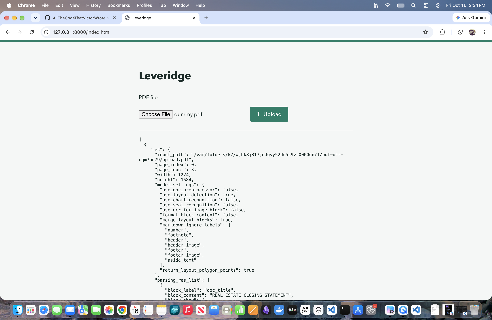

# Leveridge



## Run

```sh
python3.12 -m venv .venv
source .venv/bin/activate
pip install -r requirements.txt
npm ci
npm run build
uvicorn main:app --reload
```

Open http://127.0.0.1:8000/index.html, select a PDF, and click **Upload**.
The extracted OCR JSON is displayed on the page and logged in the browser console.
It is also saved to the local SQLite database `pdfs.db` through `PdfStore.save_pdf`.
Uploads are temporarily copied to disk for OCR and deleted afterward, including on errors.

## OCR Runtime

Before starting the server, install the PaddleOCR-VL dependencies in an environment with
a Python version supported by PaddlePaddle for your platform (for example, Python 3.12):

```sh
pip install 'paddleocr[doc-parser]>=3.7,<3.8' paddlepaddle
```

Python 3.14 has no matching PaddlePaddle distribution for this platform.
OCR requires that runtime; installing `paddleocr` alone is not sufficient.
The model loads on CPU during server startup, downloading missing weights automatically.
The terminal logs loading, readiness with elapsed time, or initialization errors.
The server accepts requests only after `PaddleOCR ready` and `Application startup complete`.
Cached weights are reused, but each server restart or auto-reload initializes the model again.

## Endpoints

The frontend uses React 19 JSX components in `components/`, compiled with esbuild.
Node.js and npm are required to install and build the frontend. React is bundled locally;
the page no longer loads React from a CDN.
After editing JSX, run `npm run build` and refresh the page, or run `npm run watch`
in a separate terminal to rebuild automatically. Build the frontend before starting FastAPI.

- `GET /index.html` serves the demo page.
- `POST /read` accepts a multipart file field named `file` and returns the JSON list from `read_pdf`.
- Filenames must end in `.pdf`; file contents are not validated.

FastAPI's interactive API documentation is available at http://127.0.0.1:8000/docs.
